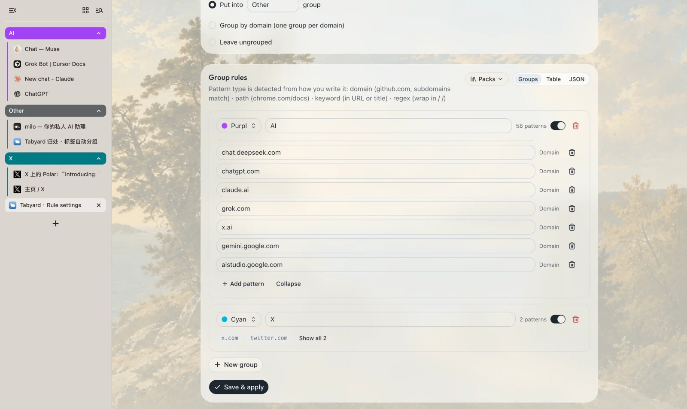
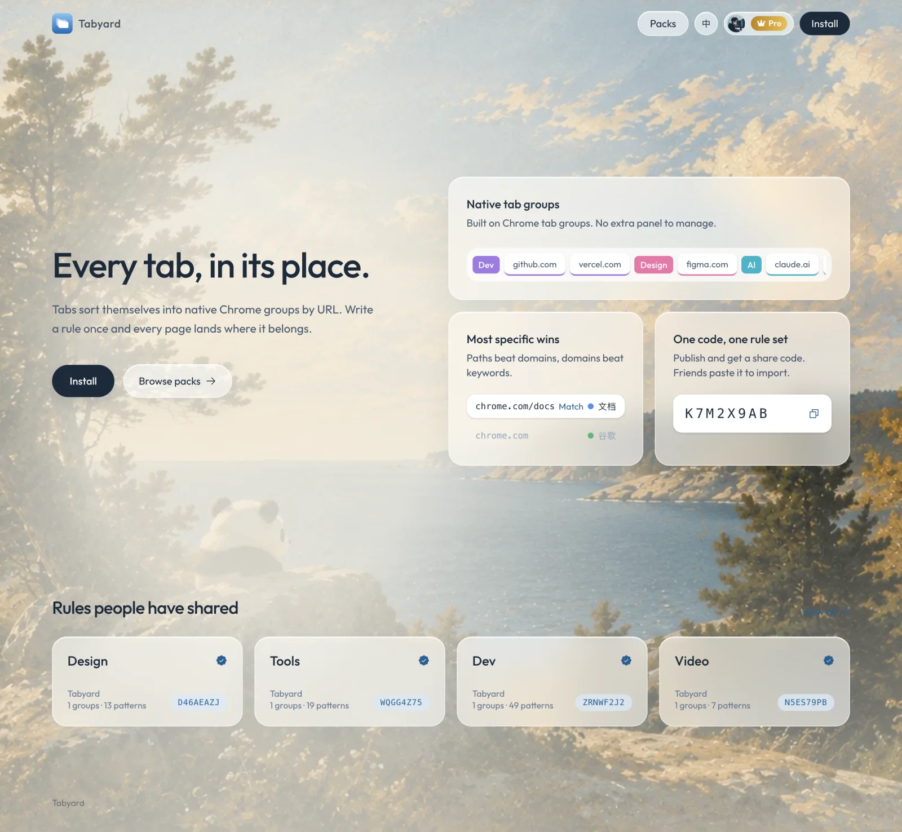
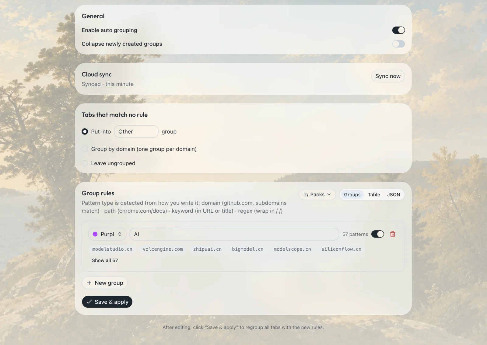
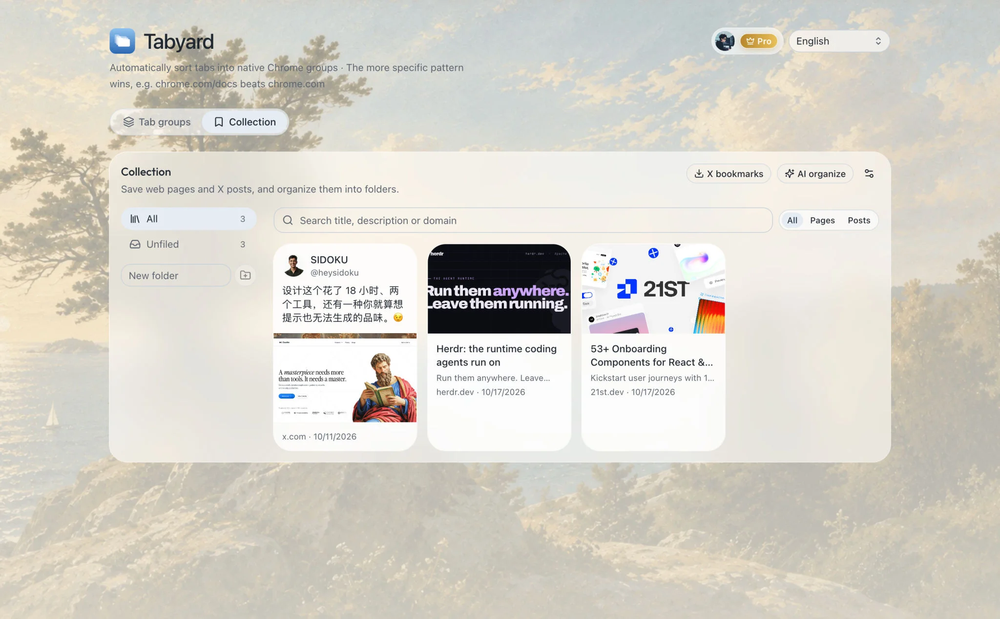
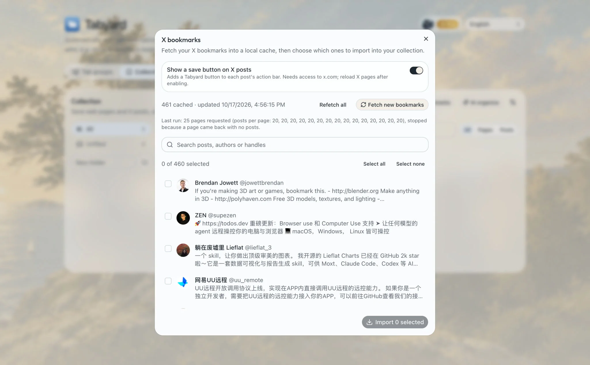
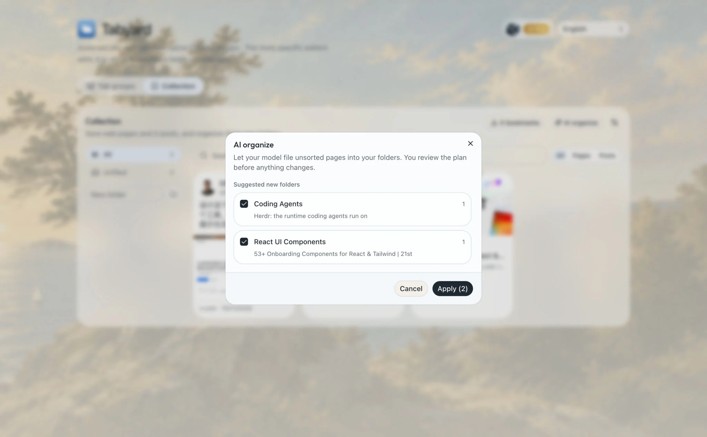
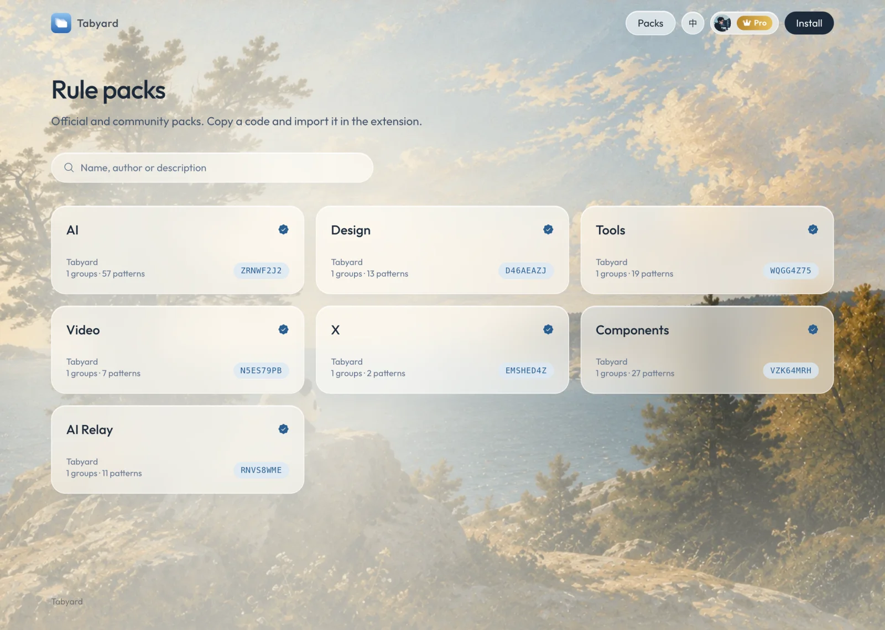
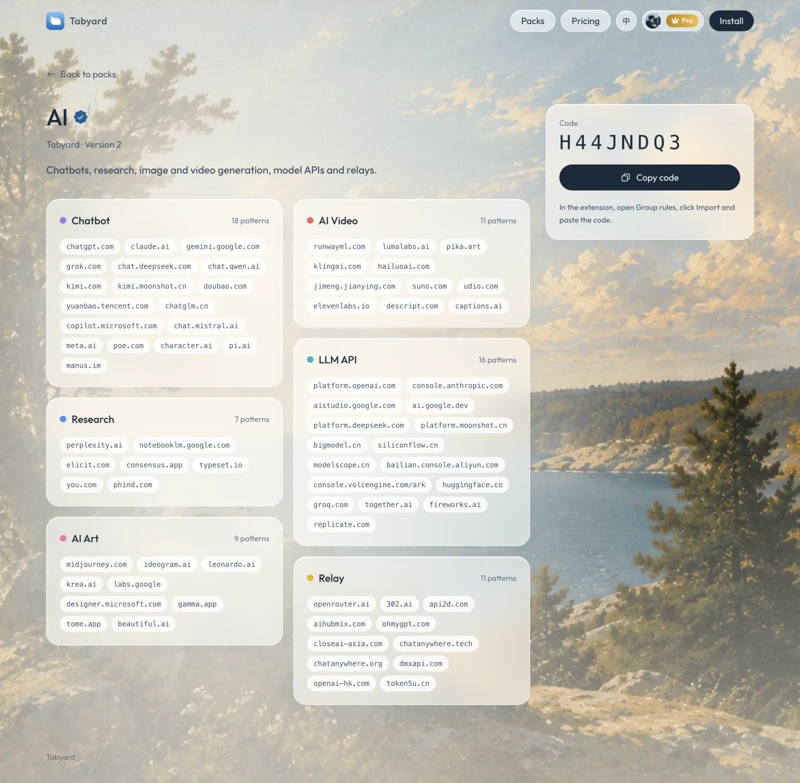

# Tabyard 归处

按规则把标签页自动归入 Chrome 原生分组的浏览器扩展,附带规则包分享网站和 Pro 云同步。



## 功能

- **自动分组**:按规则把标签页归入 Chrome 原生标签组,新开和跳转的标签页都会即时归类。
- **四种匹配方式**:域名(含子域名)、路径、关键词(URL 或标题)、正则。多条规则命中时,写得越具体的越优先,例如 `chrome.com/docs` 优先于 `chrome.com`。
- **未命中处理**:放进「其他」分组、按域名各自成组,或保持不分组。
- **规则包**:导入、导出、发布和分享规则,通过短码一键导入。网站上有官方规则包可浏览。
- **网页收藏集**:在弹窗里一键收藏当前网页(自动读取标题、描述和封面图),按文件夹整理,支持搜索、编辑、批量移动和删除。仅保存在本机,不同步。免费版最多 3 个文件夹。
- **X 书签**:通过 X 自己的接口把书签抓取到本地缓存,挑选后批量导入;也可以在帖子页的操作栏里直接收藏(需要授权访问 x.com,默认关闭)。
- **AI 整理**:接入自己的 OpenAI 兼容模型,把未分类的收藏归入已有文件夹,并给出新建文件夹的建议。先预览再应用,可撤销。
- **Pro**:不限分组数量、按域名自动分组、多设备云同步、收藏集不限文件夹并支持 AI 整理。免费版最多启用 3 个分组。
- **多语言**:中文和英文,界面和默认分组名跟随语言。

## 截图

官网首页:



扩展设置页:



网页收藏集:



导入 X 书签与 AI 整理:

| X 书签 | AI 整理 |
| --- | --- |
|  |  |

规则包列表与详情:

| 规则包列表 | 规则包详情 |
| --- | --- |
|  |  |

## 项目结构

npm workspaces 单仓库:

| 目录 | 说明 |
| --- | --- |
| `apps/extension` | 浏览器扩展。WXT、Manifest V3、React 19、Tailwind v4、shadcn/ui、i18next |
| `apps/web` | 官网与后端。TanStack Start 部署在 Cloudflare Workers,D1 存储,Better Auth 登录,Creem 收款 |
| `packages/shared` | 两端共用的类型、规则匹配和 zod 校验 |

## 本地开发

需要 Node.js 20+。

```bash
npm install

npm run dev:web    # 官网与 API
npm run dev:ext    # 扩展,WXT 会打开带扩展的 Chrome
```

扩展通过环境变量 `WXT_API_URL` 指向后端,在 `apps/extension` 下的 `.env.*` 文件里配置。

网站本地密钥写在 `apps/web/.dev.vars`(已被 git 忽略),需要的变量包括 Better Auth、GitHub 与 Google OAuth、Creem 的密钥。

初始化本地数据库:

```bash
cd apps/web
npx wrangler d1 migrations apply DB --local
```

## 构建与部署

```bash
npm run compile                          # 全部类型检查
npm run build:ext                        # 构建扩展
npm run zip -w @tabyard/extension        # 打包用于商店上传

cd apps/web
npx wrangler d1 migrations apply DB --remote
npm run deploy                           # 构建并部署到 Cloudflare Workers
npm run cf-typegen                       # 修改 wrangler.jsonc 后更新类型
```

线上密钥用 `wrangler secret put` 设置,不要写进仓库。

## 云同步如何工作

同步内容为分组规则和设置,语言偏好不同步。仅 Pro 用户可用,服务端和扩展端都会校验。

- 每次保存都会记录 `modifiedAt`,以最后修改者为准,不做合并。
- 扩展启动、打开设置页、每 30 分钟拉取一次云端;本机有改动时自动推送。
- 本机和云端都已有规则且从未同步过时,会让用户选择保留哪一份。
- 接口 `/api/sync`:未登录 401,非 Pro 403,云端更新则 409。

## 其他

- 管理后台在 `/admin`,仅 `ADMIN_EMAILS` 里的邮箱可进入,可查看订单和管理折扣码。
- 官方规则包是按主题划分的多分组包，种子数据在 `apps/web/migrations/0008_official_multi_group.sql`，上线后在 `/admin` 里编辑。
- 价格页在 `/pricing`，价格实时读取 Creem 商品（`CREEM_PRODUCT_ID`）。
